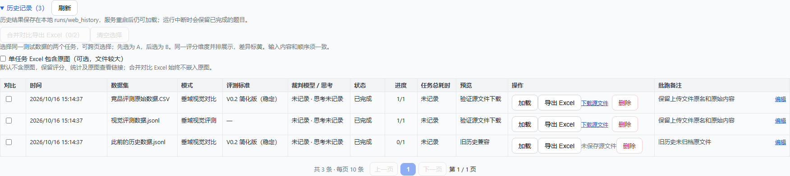

# auto-eval-agent · 垂域视觉评测 Web 评估台

> 📖 模式详解见 [docs/垂域视觉评测.md](docs/垂域视觉评测.md)；[docs/项目文档.md](docs/项目文档.md) 是早期通用评测框架（盲评/多裁判/元评测）的历史文档，仅作背景参考，其中多数能力已下线。

面向**录屏答题视频**的 LLM 评测工具，只保留两种评测模式、一位裁判：

| 模式 | 说明 | 裁判 |
| --- | --- | --- |
| **垂域视觉评测**（`rich_content`） | 识别回答中的挂卡（天气/音乐等垂域卡片）与 Superlink，统计数量、判定适用性，标记需人工复核的条目 | 终端用户（`judge_2`） |
| **垂域视觉对比评测**（`compare`） | 同一问题的两个或三个回答视频；任务级选择 V0.2 简化版、1022 优化或 V0.3 标准 | 终端用户（`judge_2`） |

裁判「终端用户」使用多模态模型，一次生成评审说明和结论 JSON，不联网、不调工具。仓库默认配置为采购渠道 `qwen3.8-flash`；页面可选择 `qwen3.5-397b-a17b` / `qwen3.8-flash` 的不同渠道，支持思考开关的渠道可独立设置原生思考。每个任务固定模型及思考设置，恢复和失败补跑沿用原配置。固定采样参数有助于控制波动，但不能保证跨模型或服务版本逐字复现。

升级、配置示例、历史兼容和限流说明见 [裁判模型与思考模式](docs/judge-model-thinking.md)。

推理参数的位置、稳定采样组合、任务时间基准和复跑边界见 [推理一致性配置](docs/inference-reproducibility.md)。六个模型配置共用 65536 token 输出上限，两处视觉输出预留同步为 65536；单次请求总超时 1800 秒，连续无数据超时 300 秒，单题默认超时 3600 秒。已保存的全局超时及历史任务参数优先于新默认值。正常评审与 JSON 修复共用采样设置，思考模式由所选模型配置决定。

## 数据流

```
JSONL（含 video_path / video1+video2）→ [抽帧] 场景切分 + 关键帧提取
    → [裁判] 单轮多模态直出逐题评判 → [SSE] 前端实时出结果
    → [导出] XLSX / 抽帧 zip / 单题 judge_calls JSON
```

---

## 安装

```powershell
# 1. 安装依赖（Python 3.10+；web 组提供评估台前后端）
pip install -e ".[dev,web]"

# 2. 配置密钥：项目根目录建 .env，至少填入
#    SILICON_FLOW_API_KEY=...   # 裁判模型

# 3. 按需调整配置
#    config/judges.yaml               裁判模型（单轮直出，不联网不调工具）
#    config/visual_modes/rich_content.yaml   抽帧算法参数 + 垂域显示名映射（两种模式共用）
```

> ⚠️ **环境注意**：本机若 `python`（hermes venv）与 `pip`（anaconda）不一致，下面所有启动命令请用 `& "D:\ProgramData\anaconda3\python.exe" -m ...`，否则报 `ModuleNotFoundError`。

---

## 启动与终止

> 本项目**前后端一体**：FastAPI 后端同时托管前端页面（[web/static](src/auto_eval/web/static/)，Vue3 CDN、**无需构建**）。**启动 web 服务 = 前后端都起来了**，浏览器访问即可，没有独立的前端启动步骤。

**启动**——在独立 PowerShell 终端运行，**保持窗口开着**：

```powershell
cd auto_eval_agent-多轮稳定版
$env:PYTHONPATH=".\src"
python -m uvicorn auto_eval.web.server:app --host 0.0.0.0 --port 8054
```

看到 `Uvicorn running on http://0.0.0.0:8054` 后，浏览器打开 **http://localhost:8054** 。

界面操作：选择评测模式 → 导入 JSONL（多轮会话可导入 CSV，按 `session_group` 串行、`turn_index` 排序）→ 选择裁判模型、思考模式、评测标准与并发数 → 开始评测，SSE 实时出结果，完成后可导出。

新导入的 JSON / JSONL / CSV 会保留上传时的原始文件。历史记录和“选择历史数据”中可点击“下载源文件”，下载的文件名、格式和字节内容与上传一致；复用历史数据新建测评也会保留源文件。升级前未保存源文件的历史任务及手动录入任务显示“未保存源文件”，不会从测评结果重建文件。

源文件单文件上限为 100 MiB，归档与临时上传均保存在 `runs/web_history` 下。迁移或备份时需保留整个目录；删除历史会清理该任务的源文件副本，其他复用任务不受影响。临时上传保留以支持同一页面重复提交评测。



垂域视觉对比支持多套并存的评测协议，包括 V0.2 简化版、稳定 plus、评分校准、思考暴露优化、V0.3、问答闲聊 V1/V2 和时效性评估。本次新增 `qa_competitor_compare@0.2-simplified-1022`（V0.2简化版（1022优化），实验，1–5 分），默认仍为 `qa_competitor_compare@0.2-simplified`。协议不仅冻结 Prompt，还冻结输出 Schema、Gate 规则和分数范围。任务一旦创建就不能更换协议；失败补跑强制继承原任务协议。若要用另一标准重评同一数据，应新建任务，避免不同口径的结果写入同一任务。

1022 版本的人工标注规则、七维分档及冲突取舍见 [测评标准](docs/compare-standard-1022.md)，接口合同、结构化输出配置和错误排查见 [实现说明](docs/compare-1022-implementation.md)。新版本严格区分合法 NA 与技术失败；不通过模型修复补造评分，也不静默清分。

运行中仍可继续提交新的全量评测任务。后端按 FIFO 队列逐个启动任务，任意时刻只运行一个队列项；每个任务开始后，仍按它提交时设置的 `concurrency` 并发评测内部题目。页面顶部的“任务队列”会显示当前运行项、等待顺序和进度，尚未开始的任务可取消、上移或置顶（不会打断当前运行项）。`GET /api/queue` 可获取队列状态，`DELETE /api/queue/{job_id}` 可取消等待项，`PATCH /api/queue/{job_id}/position` 可调整等待位置。队列驻留在当前服务进程中，服务关闭时尚未开始的排队任务会标记为中断。

已完成任务若存在技术失败 case，可在结果区手动勾选后点击“重跑所选”，或点击“重跑全部失败项”。失败补跑会以独立 `retry` 队列项进入同一个 FIFO；只有补跑成功的结果会覆盖原任务同一行，再次失败只记录补跑状态并保留原失败结果。补跑完成后汇总和后续导出的 CSV/XLSX 会同步更新。接口为 `POST /api/eval/{task_id}/retries`，补跑状态可通过 `GET /api/eval/{task_id}/retries/{retry_id}` 查询。

**终止**：在该终端按 `Ctrl+C`。

> 端口被占（进程没清干净）时强制清理 8054：
> ```powershell
> Get-NetTCPConnection -LocalPort 8054 -State Listen | ForEach-Object { Stop-Process -Id $_.OwningProcess -Force }
> ```

### 输入格式（JSONL，每行一题）

问答闲聊新增 **V2·1-5分（候选）**，可在对比模式的评测标准中选择 `qa_chat_compare@1.1`。V1 和默认标准保留；V2 使用独立的 56/78 键输出合同，统计、导出与人工基准同步支持。[使用与版本说明](docs/qa-chat-compare-v2-implementation.md)。

**V0.2简化版（1022优化）**使用 `qa_competitor_compare@0.2-simplified-1022`，当前修订 `0.2.4 / compare_1022_v2`。双产品和三产品使用独立 Prompt 与解析模型，完整输出分别为 36、47 个字段：全部输入状态最先，Gate 理由与对应判定相邻，每个维度按适用性→原因→评分排列，冲突理由与结论最后。任一 Gate 未通过或无法确认时，该产品六维均为 NA；准确性不再送模型评估，Excel 保留原列并填空。当前 Prompt 仅使用各产品的 `contextN`，不注入评测运行时间或共享 `context`。导入 compare 数据时，每个参评产品的背景都须为非空字符串；仅当 `context1` 字段不存在时兼容读取 `context` 为产品1背景，显式空值不回退。旧修订 `0.2.1`、`0.2.2`、`0.2.3` 仍按各自冻结规则恢复。[测评标准](docs/compare-standard-1022.md)及[输出与实现说明](docs/compare-1022-implementation.md)。

**时效性评估V1·1-3分（候选）**使用 `timeliness_compare@1.0`，当前修订 `1.0.2 / timeliness-result-3`。在原有两个Gate和三个评分维度之外，同次调用输出整组“内容冲突理由”和“有冲突／无冲突／不确定”；检测规则沿用v0.2稳定plus，冲突不自动改变分数。页面、历史、CSV/XLSX及统计同步展示，旧修订仍按原合同读取和续跑；使用新规则重评旧数据需新建任务。见[时效性评估完整标准](docs/timeliness-standard-v1.0.md)和[完整Prompt](docs/timeliness-evaluation-prompt-final.md)。

- **垂域视觉评测**：`query`（必填）、`video_path`（必填）、可选 `id` / `context`（可信背景条件，可写当前时间地点）/ `category`（垂域）/ `answer_text` / `task_start_time`+`task_end_time`（截取作答区间）。
- **垂域视觉对比评测**：`query`、各产品非空 `contextN`，以及完整的 `screenshot1/2` 或 `video1/2`（必填）；`answer1/2` 可选。三产品另需 `context3` 和同类型的第三产品视觉材料。只有 `context1` 字段不存在时，兼容读取 `context` 为产品1背景。

### 裁判明细日志（可选）

在 `.env` 设 `AUTO_EVAL_JUDGE_TRACE=runs/judge_calls.jsonl`，每次裁判评判的完整明细（LLM 响应、对话历史）会追加到该文件，便于调试/审计；前端也可按题导出 judge_calls。**不设则不记录、零开销**。

---

## 目录

- `schema.py` 数据模型（EvalItem / RichContentObservation / VisualCompareObservation）
- `judges/` 评测引擎：`base.py`（单轮直出 LLM 客户端 + JSON 定向修复）｜`rich_content_judge.py`｜`visual_compare_judge.py`｜`compare_protocols.py`（版本注册、Schema 和 Gate 语义）｜`visual_compare_prompt_v02_simplified.py` / `visual_compare_prompt_v03.py`（版本化 Prompt）
- `web/` 评估台：`server.py`（FastAPI 路由）｜`runner.py`（评测编排：抽帧→逐题评判→汇总）｜`parse_input.py`（JSONL/CSV 解析）｜`video_prepare.py` + `media.py`（抽帧）｜`history.py`（快照与导出）｜`static/`（前端）
- `config/` `judges.yaml`｜`visual_modes/rich_content.yaml`（含 category_display 垂域显示名）
- `tests/` pytest 单元测试（不访问真实模型/网络）

## 需要你补充的输入

1. 录屏视频文件（JSONL 中写相对/绝对路径，上传目录也可通过界面上传）；
2. `SILICON_FLOW_API_KEY`（裁判模型）。
