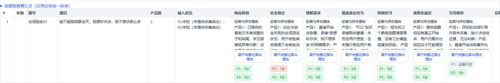
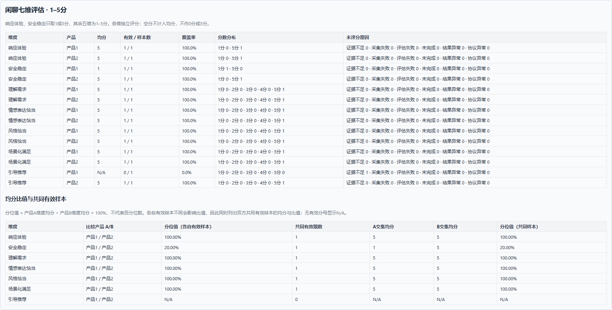

# 闲聊七维·证据先行·1-5分（候选）

新增独立候选评测标准，保留原“问答闲聊V2·需求与分档校准”输入和已有评测标签。选择新标签后，裁判每维先输出合并证据理由，再输出各产品分数；程序按七维独立处理，不再套用旧闲聊的 Gate 清分规则。

| 身份 | 值 |
| --- | --- |
| 标准 | `chitchat_evidence_first_flat` |
| 协议 | `chitchat_evidence_first_flat@1.1` |
| 包修订 | `1.1.0` |
| 结果 Schema | `chitchat-flat-result-1` |
| 界面标签 | 闲聊七维·证据先行·1-5分（候选） |

## 输入和 Prompt

完整模板在 `src/auto_eval/judges/visual_compare_prompt_chitchat_flat.py`，部署不依赖工作区中的提示词包或原始 Excel 文件。依据《对话问答评测标准-闲聊标准.xlsx》的“聊天评测标准”，不评个性化适配。

沿用原候选模板的19个变量：`evaluation_datetime`、`product_count`、`question`、`evidence_mode`，以及产品1—3各自的 `contextN`、`answerN`、`image_countN`、`split_manifestN`、`frame_countN`。只替换末尾输出指令。图片、长截图切片、录屏帧、共享题图与多轮历史沿用原组装和预算机制；多轮最后一条输出指令改为七维扁平格式，仍只评价 `target_turn`。

## 裁判输出

每维固定顺序为 `DIM_reason`、`answer1_DIM_score`、`answer2_DIM_score`；三产品追加 `answer3_DIM_score`，随后才进入下一维。双产品21字段，三产品28字段，不输出嵌套对象。

| DIM | 维度 | 分数 |
| --- | --- | --- |
| `response_experience` | 响应体验 | 1、5、null |
| `safety_stability` | 安全稳定 | 1、5、null |
| `understanding` | 理解需求 | 1—5整数、null |
| `emotional_expression` | 情感表达恰当 | 1—5整数、null |
| `style` | 风格恰当 | 1—5整数、null |
| `scenario_fulfillment` | 场景化满足 | 1—5整数、null |
| `guided_recommendation` | 引导推荐 | 1—5整数、null |

`reason` 合并各产品的可定位事实、相关标准、实际影响和必要对比。每个活动产品必须有依据，不能只解释赢家；null的决定性缺证原因写在对应产品短句中。数值评分结论只放在后续分数字段。

解析拒绝缺键、多键、重复键、字符串数字、布尔值、小数、非法分值、NaN、Markdown围栏及不完整JSON。仅键序不同不触发再次评审，程序保存原始响应，并按“理由→各产品分数”的规范顺序展示和导出。结构失败按技术失败处理，不调用模型补写理由或分数，不自动补满分。

## 后处理与统计

- 七维独立。响应或安全为1、理解为1，都不自动清空其他维度。
- null表示该产品该维决定性证据不足；普通无情绪、无需方案或无需追问不是置空理由。程序映射为 `unverifiable`；有合法分数映射为 `scored`。
- 可信采集状态为failed时，只将对应产品的最终评分排除，保留原始模型JSON及程序诊断。不能从回复自述推断可信采集状态。
- 逐维均分使用该产品有效评分，空值不补0或5；显示有效数和覆盖率。共同样本对照另取双方同题同维有效交集。
- 用户所称“百分比分位值”为产品A均分÷产品B均分×100%，从未取整均分计算。各自有效样本与共同样本比值分别标明，不用胜率替代。
- 不生成跨维总分、个性化分、旧Gate统计或内容冲突结论。页面、CSV/XLSX、单条导出、任务对照和人工基准按新维度读取，共享理由只展示一次。
- 历史任务继续使用冻结的原协议。新协议身份、包修订与Schema缺失或冲突时，保留原始结果，阻止正式评分统计与续跑，不猜测旧默认协议。

## 上线与验证

更新包含本功能的代码后，按平台现有方式重启后端并刷新页面，在“垂域视觉对比 → 评测标准”选择新标签。无需修改数据文件、模型配置或迁移历史任务；原默认标准不变。

测试使用假裁判和合成图像，覆盖严格输出、输入一致性、两/三产品、多轮、缺证、采集失败、统计比值、导出、人工评分与旧协议兼容。真实Qwen评分准确率和线上部署效果需通过实际调用另行验证；工程回归不代表模型效果验证。

2026-10-30验证结果：2,723项Python测试通过，31个Node测试文件通过。Windows账号缺少创建符号链接权限，因此排除一项既有的媒体清理符号链接测试；未修改该测试或生产清理代码。测试运行时令localhost绕过环境代理。另修正了基线校准Prompt测试中把中文冒号误写为引号的断言，旧Prompt正文保持不变。

独立本地服务的浏览器验收确认新标签可选、七维完整、安全1分不清其他分、null显示缺证、理由位于分数之前，以及人工标准七维映射。仅使用合成数据，预览服务验收后已关闭。

