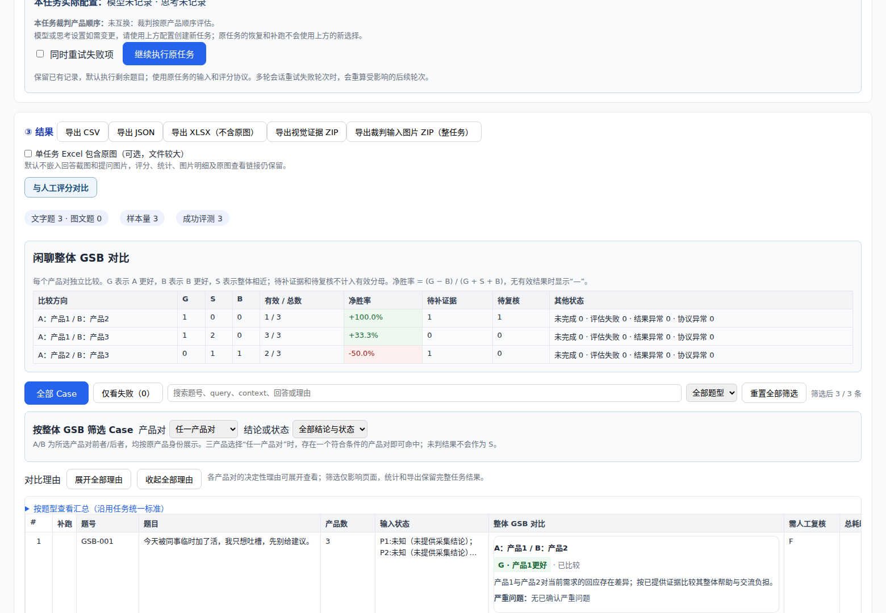
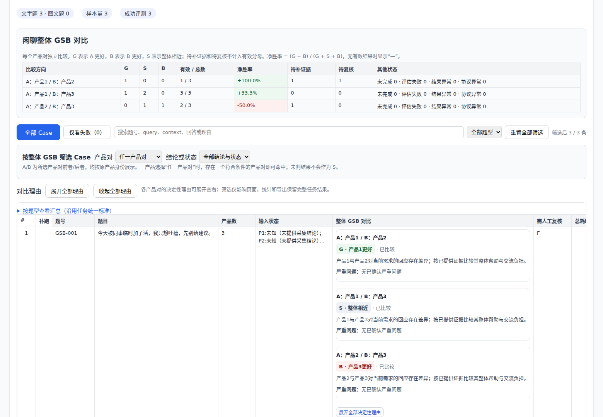

# 闲聊整体 GSB 对比评估

同一问题下每个产品对只输出一个整体 G/S/B。标准依据《手机智能助手闲聊 GSB 评测标准 V1.0》：先确认可比较，确定当前诉求，比较严重问题，再比较需求满足和交流负担。个性化为低优先级辅助依据，不设置独立权重，也不输出六维分数或 Gate。

## 选择入口与冻结身份

新建“垂域视觉对比”任务，选择：

`闲聊GSB对比 | 标准S1.0 | Prompt P01 | Qwen3.8-Flash | 实验`

| 项目 | 值 |
| --- | --- |
| 版本代号 | `CHATGSB-S1.0-P01` |
| evaluation_profile | `chitchat_gsb_compare@1.0` |
| standard_id | `chitchat_gsb_compare` |
| standard_version | `1.0` |
| bundle_revision | `1.0.0` |
| result_schema_version | `chitchat-gsb-result-1` |
| 结果类型 | `pairwise_gsb` |
| 数值分数范围 | 无，公开元数据为 `null` |

这是新的相对比较标准，使用独立家族代号，避免与旧闲聊 1–5 分标准共用身份。标签沿用“标准名称 | 标准版本 | Prompt 序号 | 裁判模型 | 状态”规范。标签中的模型是命名登记信息；实际调用模型与思考开关继续由任务的裁判模型配置决定，不被模板强制覆盖。

## 输入与现有平台对齐

| 平台输入 | GSB Prompt 中的用途 |
| --- | --- |
| query / question | 共享用户问题 |
| product_count | 2 或 3；决定实际活动的产品对 |
| context1 / context2 / context3 | 各产品自己的背景、已知条件和裁判参考；禁止跨产品补齐 |
| 旧 context | 仅作为未显式提供 context1 时的产品 1 背景别名；显式空 context1 不被覆盖 |
| answer1 / answer2 / answer3 | 各产品复制的辅助文本，不能替代实际提供的图片证据 |
| screenshotN / screenshot_metaN | 沿用长截图原图与连续切片，保持产品与图片归属 |
| videoN / framesN | 沿用录屏抽帧，识别最终稳定展示；中间态不作为最终缺陷 |
| query_images | 共享题图，明确标为用户输入，不能当产品配图 |
| session_id / turn_index / screenshot_scope | 沿用现有多轮准备；仅评价 target_turn，原始历史解释承接与指代 |
| trusted_collection_metadata | 程序提供的采集状态，不能由待评回复自述覆盖 |
| include_prior_knowledge | 沿用任务开关，控制是否使用通用先验辅助判断 |
| evaluation_datetime | 仅作评估调用时间，不代替真实产品测试时间 |

平台未独立提供的 `current_time_beijing`、`user_info`、`user_md`、`knowledge`、`resultDataList`、`intent`、`slots` 等字段保留为空；没有原始历史时 `context=[]`，不把普通背景伪装成对话。多轮采用原始用户轨迹及各产品隔离历史，禁止引入目标轮之后的材料，禁止继承前轮机评分数或结论。

沿用当前平台的证据准入规则：单轮支持长截图或录屏；多轮继续要求逐轮长截图与 `screenshot_scope=current_turn`。不放宽旧输入的校验。文本/图文输入元数据表示用户提问的模态，不表示可以省略平台要求的回答证据。

## 模型输出

双产品只输出 `pair_1_2`：

```json
{
  "pair_1_2": {
    "status": "evaluated",
    "gsb": "G",
    "reason": "用户明确只想吐槽。产品1回应具体经历，产品2主要安排未请求的任务；产品1更符合本轮需求。",
    "serious_issue": "none"
  }
}
```

每个产品对恰好四个字段：

| 字段 | 允许值与约束 |
| --- | --- |
| status | `evaluated`、`insufficient_evidence`、`needs_review` |
| gsb | evaluated 时为 `G`、`S`、`B`；其他状态必须为 JSON `null` |
| reason | 非空字符串；双方证据位置或短原话 → 实际影响 → 整体结论依据；S 也需要理由 |
| serious_issue | `none`、`A`、`B`、`both`，仅记录可见严重问题，不把采集缺失算成产品缺陷 |

每对 A 为编号较小产品，B 为编号较大产品。`G` 表示 A 优于 B，`B` 表示 A 劣于 B，`S` 表示整体接近或无清晰净优势。单方严重问题必须与胜负一致：仅 A 有严重问题时只能判 B，仅 B 有严重问题时只能判 G；矛盾结果直接拒绝，不静默改判。

三产品同时独立输出 `pair_1_2`、`pair_1_3`、`pair_2_3`，每对相同四字段。某产品缺证仅影响涉及它的产品对；不根据两对结果推导第三对，不强制形成总排名，不混合不同对手计算一个净胜率。

只有采集不完整到足以改变结论才记待补证据。原始材料明确显示产品实际空回答、生成失败或严重截断，仍是可比较的产品表现。关键事实或边界需要复核且当前不能确认时记待复核；这两种情况都不能用 S 占位。

## 程序绑定与原始审计

模型 JSON 采用独立严格 schema，拒绝重复键、未知字段、空理由、非法类型、NaN、无效活动产品对以及状态和胜负矛盾。不调用第二次模型补写理由、状态或胜负。

最终结果存于 `gsb_pairs["1_2"]` 等键，程序额外附上 `product_a`、`product_b`。`model_pair_results` 保留模型结构化原判，`raw_model_output` 与原始键值序列保留实际裁判槽位的原输出。

可信采集 `input_status=failed` 时，仅涉及该产品的最终 pair 被置为 `insufficient_evidence/null`，原判保留供审计。`partial` 不机械取消比较。双产品启用位置互换时，输入背景、文本、历史和图片共同交换，输出 G/B、严重问题 A/B、理由及可信采集归属恢复为原产品方向；原始模型文本保持不变。三产品沿用平台不允许位置互换的原规则。

## 展示与汇总

页面按产品对展示整体 GSB、状态、理由和严重问题；GSB 专用类别筛选不使用旧的分数与分差条件。证据展示、历史、重跑、暂停恢复、追加评估、CSV/JSON/Excel 和模型输入证据导出沿用通用流程。

每个有效条目与产品对只计一次，重跑采用最新结果，不按评审人数重复计票。仅 `evaluated` 且通过严格状态校验的 G/S/B 进入分母：

`净胜率 = (G 条数 - B 条数) / (G 条数 + S 条数 + B 条数)`

无有效结果时值为 `null`，页面显示“—”，不是零或平局。汇总保留 G/S/B 分布、有效样本数、待补、待复核及失败数。多轮以目标轮为统计单位，同时提供轮次、会话内分布及输入模态分组，不把多个轮次自动合成会话 GSB。

历史仅接受精确的协议、实现版本与 schema 身份。缺少冻结版本或存在冲突时保留原数据并提示诊断，禁止借用旧 1–5 分协议恢复成 GSB 结果。人工基准同样使用独立成对分类标签，旧数值评分不会迁移为 GSB。

## 实现与验证

Prompt：`src/auto_eval/judges/visual_compare_prompt_chitchat_gsb.py`。

严格合同：`src/auto_eval/judges/chitchat_gsb_schema.py`。

新增测试覆盖模型合同、图片归属、双产品反转、双／三产品、多轮隔离、可信采集失败、统计分母、历史恢复、导出及人工分类对照。运行本地测试时使用 `PYTHONPATH=src python -m pytest -m 'not integration'`，确保导入当前工作区。UI 回归使用 `node --test tests/*.cjs`。测试使用模拟裁判，不消耗真实模型调用；评分与人工的一致性仍须以盲评集验证。

界面验收截图使用模拟结果，展示三组比较、独立有效分母和未判状态：




