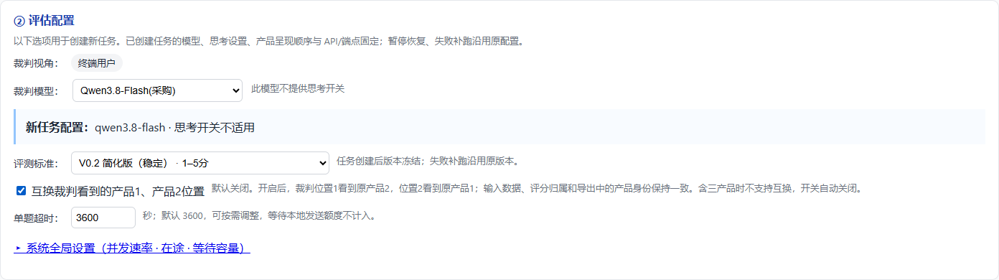
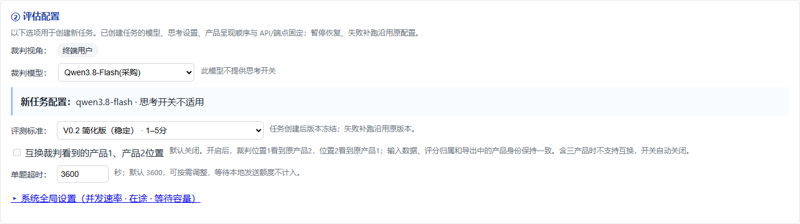

# 双产品评估：可选交换裁判输入位置

## 需求目标

双产品对比评估存在产品位置偏差验证需求。同一份测试集中的产品1和产品2对应固定的业务产品，评估人员需要在新建任务时选择裁判看到的产品先后顺序，方便用同一批数据比较顺序对评估的影响。

新增任务选项 `reverse_product_order`，布尔类型，默认 `false`。关闭时沿用当前行为；开启时，裁判 prompt 中的第一个产品位置使用原产品2，第二个产品位置使用原产品1。产品的业务身份、上传字段、结果字段及统计口径保持原有对应关系。三产品评估不支持该选项。

## 使用范围与交互

对比评估的数据输入区增加复选项“交换裁判看到的产品1 / 产品2位置”，默认不勾选，说明为：

> 仅适用于双产品评估。开启后裁判先看到原产品2，再看到原产品1；原始产品字段和结果归属保持不变。

- 上传新测试集或载入历史数据后，可以在创建新任务前选择顺序。
- 三产品数据或包含三产品用例的混合数据集不可开启。前端应禁用或清除该选项，并说明“仅双产品评估支持位置互换”。后端再次校验，防止绕过界面提交。
- 非对比评估不可开启；旧请求不传此字段时按关闭处理。
- 任务创建后冻结顺序设置。暂停后继续、失败补跑、追加或更新任务内用例，都使用该任务的既定顺序；请求修改顺序时返回明确错误，提示另建任务。
- 复用历史测试集创建的是新任务，其顺序由当前新任务设置决定。复用操作保留源测试集的产品字段，不根据源任务的顺序交换输入数据。

该选项是任务设置，无需修改上传文件格式，也不要求新增测试集列。

## 产品身份与位置契约

“原产品”指测试集中的固定产品身份；“裁判位置”指 prompt 内用于组织输入和要求模型输出的产品编号。

| 设置 | 裁判位置1 | 裁判位置2 | 结果中的产品1 | 结果中的产品2 |
| --- | --- | --- | --- | --- |
| 默认 / `false` | 原产品1 | 原产品2 | 原产品1 | 原产品2 |
| `true` | 原产品2 | 原产品1 | 原产品1 | 原产品2 |

例如，测试集产品1是小艺、产品2是豆包。开启后裁判看到“产品1”位置的豆包和“产品2”位置的小艺。裁判若判第一个位置胜出，平台结果应仍表示原产品2（豆包）胜出，导出的产品1回答依然是小艺回答。

### 输入边界

在进入裁判输入构造时，根据冻结选项建立位置与原产品的映射。交换产品绑定的全部证据：回答文本、独立上下文、录屏帧、长截图及其元信息、多轮对话中的产品回答与对应证据，以及程序提供的产品级采集状态。问题、题图、题号、分类、评估标准和公共任务设置不受影响。

应通过临时视图或副本构造裁判输入，不能直接修改任务的原始 items、源字段、上传文件或历史数据。媒体清理、下载及快照管理继续依据原产品输入，避免交换造成证据归属或文件生命周期变化。

### 输出边界

裁判输出首先按实际 prompt 的位置编号进行现有解析与校验，再映射为原产品身份提供给平台业务链路。映射必须覆盖：

- 产品级分数、状态、Gate、原因、证据和结构化结论；
- 双产品胜负、产品 ID、排名组及其他产品引用；
- 面向平台用户展示的解释中能够明确识别的产品编号。

应保持一组产品结果整体迁移，不能只交换分数而留下另一个产品的原因或证据。映射后的平台结果进入现有汇总、结果列表、筛选、人工对照及导出流程，确保所有产品统计仍对应原测试集身份。

裁判原始响应、原始请求及调试追踪保留实际调用内容，不将其伪装成原产品编号。对这类原始材料应附带实际输入顺序说明，避免用户将原始响应中的位置编号误读为测试集产品身份。解析失败时同样保留顺序信息，便于定位失败调用。

## 数据与兼容性设计

请求在任务的 `options` 中传入：

```json
{
  "reverse_product_order": true
}
```

字段只接受布尔值；缺省值为 `false`。字符串 `"false"` 等非布尔输入应返回校验错误，避免错误启用反转。

后端在任务创建时校验评估模式、每条用例的产品数量和选项类型，并持久化选项。任务更新和补跑必须检查与冻结选项的一致性；更新请求未传该选项时继承任务值。反转任务追加三产品用例时拒绝整个更新，避免任务内出现无法解释的顺序混用。

任务快照通过 `options.reverse_product_order` 冻结设置；历史详情、单题结果和调用审计使用以下字段说明实际顺序：

| 字段 | 默认双产品 | 互换双产品 |
| --- | --- | --- |
| `reverse_product_order` | `false` | `true` |
| `judge_product_order` | `[1, 2]` | `[2, 1]` |
| `judge_product_order_note` | 裁判位置1=原产品1，位置2=原产品2 | 裁判位置1=原产品2，位置2=原产品1；结果按原产品展示 |

`judge_product_order` 的第一个元素表示裁判位置1使用的原产品编号。单题结果保留实际使用的顺序信息，方便脱离任务详情单独解释。

旧任务及旧结果缺失顺序字段时按未反转解释，无需迁移历史文件。默认未反转任务应沿用现有 prompt、输出解析和产品数据口径，不因新增开关重写已有输入。

## 导出要求

CSV、XLSX 和 JSON 等结果导出都应清楚标记裁判输入顺序。用户下载后无需再查询页面即可判断是否反转。

建议显示文案：

- 未反转：“未互换；裁判输入顺序：原产品1 → 原产品2”。
- 已反转：“已互换；裁判输入顺序：原产品2 → 原产品1。产品数据及结果归属仍按原产品编号”。

三产品任务保持原有顺序，并可明确记为“原产品1 → 原产品2 → 原产品3”。旧历史按其原有顺序导出。

逐题导出应带顺序说明，XLSX 的任务说明或统计说明中也应可见该信息。原有产品1 / 产品2的名称、回答、上下文、截图、原始源字段、分数及统计列不交换、不重命名。原始上传文件下载保持原始文件内容；反转说明属于评估结果和任务元信息。

实际导出列为“裁判产品位置互换”“裁判产品呈现顺序”“裁判产品位置说明”。长截图预处理参数、请求图片序列和 Prompt 明细也包含上述说明；其中普通“产品序号”表示原产品身份，“裁判位置”单独表示实际 prompt 位置。证据 ZIP 的 manifest 保留 `product_no` 作为裁判位置，使用 `original_product_no` 表示原产品，原始图片字节、路径、哈希和请求内容不变。未记录实际请求的旧证据不填写“裁判位置”，避免把预处理顺序当作实际回放。

## 边界与非目标

- 不增加三产品排列、随机顺序、逐题独立选择或自动双向评估。
- 不修改评估标准、打分规则、裁判模型、重试策略或人工标注原始数据。
- 不交换上传字段名、原始文件列和产品名称，不修改历史任务来模拟反转。
- 混合数据集中只要存在三产品用例，就不能开启任务级反转。
- 开启反转后遇到采集失败、缺失证据、模型返回格式错误，继续沿用现有错误处理，并标明该次裁判顺序。

## 验收用例

1. 不传选项或显式传 `false`：双产品的裁判输入、解析结果及原始产品字段与原行为一致。
2. 双产品传 `true`：假裁判确认回答、独立上下文、截图 / 帧及多轮证据均成组互换，原始 items 深度比较不变。
3. 反转时假裁判判位置1胜：平台仍判原产品2胜；分数、原因、Gate、状态和排名都归属对应原产品。
4. 平局、不可评分、输入失败、单产品缺失有效分和各种现有输出协议均能保持正确归属。
5. 三产品或含三产品的混合集开启反转：前端不允许选择，后端返回明确校验错误；默认三产品流程仍正常。
6. 非对比模式开启反转，或字段传字符串 / 数字等非布尔值：返回明确校验错误。
7. 保存并重新加载任务、暂停续跑及失败补跑：保持原顺序设置，不发生二次交换或设置丢失。
8. 对已有任务请求不同设置，或向反转任务追加三产品用例：拒绝变更，原任务和已有结果不变。
9. 从已反转历史任务复用数据：载入后产品字段仍与原上传数据相同，新任务按当前开关评估。
10. CSV / XLSX / JSON 导出：可独立判断实际裁判顺序，产品字段及统计仍按原身份；原始文件下载内容不变。
11. 旧历史缺失新字段：按未反转展示和导出，原有结果、补跑及复用正常。
12. 运行相关后端及前端回归，覆盖现有默认评估、三产品、历史、导出、媒体和重试功能。

## 部署

本功能包含后端和前端修改。部署时使用同一版本代码，重启 Web 服务并刷新页面。无需修改测试集文件、模型配置或迁移历史数据。

## 页面验收截图

使用本机合成数据完成浏览器验收：默认不勾选，双产品可以开启，切为三产品后自动取消并禁用，页面无脚本错误。






## 测试结果

2026-10-30 完成验证：后端 **2829 passed**，前端 **33 组通过**，真实 Chrome 页面验收通过。测试使用模拟裁判，不消耗真实模型额度。覆盖全部 12 种可选裁判协议、双/三产品、截图/视频/题图/多轮、评分与胜负归属、1022 合法 NA 统计、历史恢复、暂停续跑、失败补跑和各类导出。

后端全量命令：

```powershell
$env:PYTHONPATH = "$PWD/src"
$env:NO_PROXY = 'localhost,127.0.0.1,::1'
& C:/workspace/venv/Scripts/python.exe -m pytest -q --basetemp C:/workspace/po30final --deselect tests/test_remote_media_inputs.py::test_download_cleanup_cannot_remove_history_or_follow_external_symlinks
```

短临时目录用于避开 Windows 长路径限制，并置于仓库之外，避免影响项目相对路径测试。唯一排除的既有符号链接清理用例在本机报 `WinError 1314`（无创建符号链接权限）；该项环境限制已记录，未修改相关清理逻辑或原测试。
