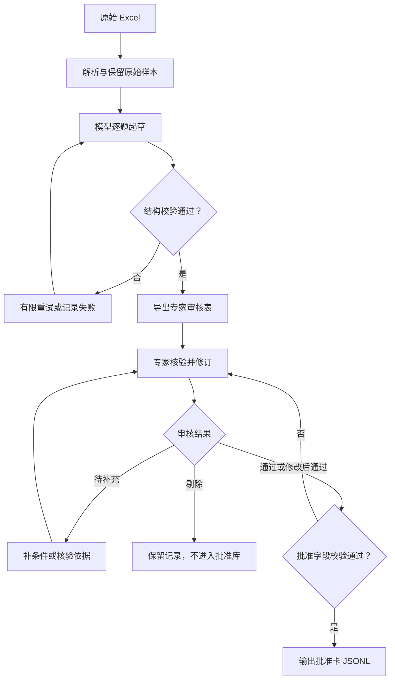

# 离线建设裁判依据 MVP 设计

版本：v1.0｜日期：2026-10-12｜项目：手机 AI Agent 问答准确性评估

## 1. 目标与交付边界

把人工筛选的《自动化评测集收集.xlsx》一类测试数据，转成逐题可审核的判定卡草稿。模型先生成必要字段，专家修订并确认事实与适用条件，程序再将批准记录输出为 JSONL 卡库，供后续评估阶段使用。

首版闭环是：**原始 Excel → 模型草稿 → 专家审核 Excel → 专家确认 → 批准卡库**。原表中的“标准答案”“参考答案”“是否强时效性”均是候选信息，不能替代事实核验，也不直接决定最终判法。

本次提供离线脚本，不新增现有评估平台的模式或 UI 入口。产品回答评估、最小字段投影、事实检索和评分映射是后续接口设计，尚未接入现有运行时。

| MVP 必须建设 | 首版暂缓 |
|---|---|
| XLSX 解析、原始内容保留、批次内样本 ID | 自动采集全量现网 Query、自动构建语义树 |
| 逐题起草必要判定字段、结构校验 | 自动检索事实、网页快照采集、自动证明事实正确 |
| 专家审核表、定稿字段编辑、事实和条件确认 | 专家在线标注平台、多级审批、协同分派 |
| 明确批准门槛、JSONL 批准卡、审核追溯 | 外部数据库、自动版本演进、复杂规则引擎 |
| 开放答案、澄清题与时效条件的边界约定 | 错误严重度、置信度、准确性分数、综合评分 |

## 2. 总体流程



图中重试有上限：生成失败不能被伪装成成功草稿。批次草稿未完整覆盖原始样本时，先解决缺项，再交付整批审核表。待审核、待补充和剔除记录均不进入批准卡库。

## 3. 输入解析与原始数据保留

输入至少包含 `query`、`Query` 或 `问题` 之一。保留原垂域、数据来源、采样策略、意图层级、轮次、原时效标签、答案类型与答案内容等原始列；未知列也保留。原始输入不由模型改写。

样本按本批有效原始行顺序生成 ID，例如 `S001`。ID 是批次内身份，不是跨批次全局 ID；多批合并需配置独立前缀，例如 `B20261012_S`。不同条件下的同文 Query 可以作为不同样本。

解析要点：

- 支持 `.xlsx`，不直接支持 `.xls`。
- 按单元格格式解释时间和日期。Excel 底层的“一天比例”不能被当成数值答案；普通数值也不能擅自解释为日期。
- 原始数据公式、图片或富数据阻断导入，并提示人工核验、转写或粘贴为值；不使用可能过期的公式缓存。
- 保留多轮标记。缺少前文且影响题意时列为待补充；题面本身足以独立判定时可以先制卡。标记本身不能替代实际会话上下文。
- 主审核页只显示原答案预览；完整原答案保存在“原始输入”页。长答案按顺序拆成多行，仍可按样本 ID 无损还原。

## 4. 模型逐题生成什么

模型只负责起草候选依据，不能设置审核人、审核日期、批准状态或已核验来源。使用中文文本规则即可，不建设嵌套规则树。

| 草稿字段 | 类型 | 生成要求 |
|---|---|---|
| `sample_id` | 字符串 | 原样复制样本 ID |
| `judge_mode` | 枚举 | 确定答案核对／开放规则核验／条件澄清 |
| `question_intent` | 字符串 | 用户直接需求，避免从参考答案扩张需求 |
| `applicable_conditions` | 字符串 | 已知条件、决定答案的条件、缺失条件 |
| `suggested_answer` | 字符串 | 候选核心答案；无法确定时说明澄清或核验要求 |
| `accuracy_rules` | 字符串 | 少量编号规则，说明触发条件及准确性要求 |
| `accepted_variants` | 字符串 | 等价表达、合理精度、其他合法方案 |
| `reference_coverage` | 枚举 | 核心答案穷尽／不穷尽／待确认 |
| `conditional_rules` | 字符串 | 产品提到附加事实才核验；无必要时为空 |
| `task_completion` | 字符串 | 用户要求的数量、子问题和范围；可为空 |
| `temporal_type` | 枚举 | 稳定／动态／待确认 |
| `temporal_scope` | 字符串 | 事实适用时点、地域、版本等；待补项需明示 |
| `issues` | 字符串数组 | 原答案可疑、条件缺失、标签错配等待确认问题 |
| `evidence_to_verify` | 字符串 | 待专家查证的来源方向或复算步骤，不能冒充证据 |

程序可附加 `_generation_meta`，记录真实生成来源、模型、配置及输入／提示词 hash。该元数据不是事实可靠性的证明。

### 4.1 判定方式的含义

判定方式告诉下游裁判“按什么方法检查产品回答”，不评判 Query 本身是否准确。

| 判定方式 | 使用情形 | 示例及裁判行为 |
|---|---|---|
| 确定答案核对 | 条件明确，核心结果确定 | `13×61`：核对结果 793，接受“七百九十三”等表达 |
| 开放规则核验 | 正确答案可能有多个，参考只是其中一种 | 推荐类：核验实际推荐是否真实、符合用户约束，不能只认参考品牌 |
| 条件澄清 | 缺关键条件或有歧义，无法无条件给唯一答案 | 机油重量缺密度／是否含桶：接受追问，或明确合理假设后的估算 |

“条件澄清”不要求产品必须先提问。明确假设并给条件化答案也可以成立。即使主判法为确定答案核对，产品额外补充的事实也仍需检查。

### 4.2 题意与适用条件的含义

题意说明“用户究竟在问什么”，适用条件说明“哪些前提下这张卡的答案和规则才成立”。专家审核表将二者合并在 M 列，允许直接编辑；批准后保留合并文本，不再自动拆解专家语义。

例如“东八区和零时区差几个小时”：题意是标准时区的时差，适用条件是按 UTC+8 与 UTC+0 理解，不是问某个城市的夏令时。

例如“18升机油大概多重”：题意是估算重量；密度、温度、净重／含桶口径决定答案。若明确假设密度为 0.86 kg/L，净重为 15.48 kg；另一合理密度下的正确估算不能仅因不等于 15.48 就被判错。该假设是演示条件，不是原题已经提供的事实。

实际位置、测试时间和多轮前文由测试数据提供。不能从原参考里的店铺、日期或利率反推出真实测试条件。

## 5. 专家审核表与重点

工作簿有“专家审核”“模型草稿”“原始输入”“填写说明”四页。主表第 4 行为表头，第 5 行起每行一个样本；冻结 ID／Query 和表头，提供筛选与枚举下拉。灰色区是来源或模型提示，黄色区可编辑；颜色只是操作提示，不是 Excel 锁定保护。

| 列 | 字段 | 专家职责 |
|---|---|---|
| A—B | 样本ID、Query | 保留原样，确保没有串题 |
| C—H | 审核状态、事实确认、条件确认、审核意见、审核人、审核日期 | 填写真实审核结论与身份日期 |
| I—K | 原垂域、原答案类型、原答案摘要 | 对照原始输入，不作为已核验真值 |
| L | 判定方式 | 确认答案是否确定、是否开放或缺条件 |
| M | 题意与适用条件 | 确认需求、口径、条件及未解决缺口 |
| N | 最终答案 | 核验核心事实／计算，删除不可靠断言 |
| O | 核心准确性规则 | 确认规则可判定，避免过度必答要求 |
| P | 允许变体 | 确认等价表达、精度及合法替代方案 |
| Q | 参考覆盖范围 | 确认参考是否穷尽当前条件下的核心结果 |
| R | 按需检查规则 | 仅在产品提到附加事实时触发 |
| S | 任务完成要求 | 仅保留用户明确要求的数量、子问题、范围 |
| T—U | 时效类型、时效范围 | 绑定正确事实时点、地域或版本 |
| V—W | 核验依据、证据对应日期 | 专家补录实际支持内容／复算步骤及必要时点 |
| X | 模型待确认问题 | 逐项检查，有实质缺口就待补充 |

建议顺序：**M 题意条件 → N 核心答案 → O 规则 → P/Q 判定边界 → T/U/V/W 时效与依据**，再确认 L/R/S，最后填写审核状态和事实／条件确认。

核验依据初始留空；模型建议的核验方向仅保存在“模型草稿”页。V 列应说明来源及支持事实、可复算的步骤或专家事实确认依据，不能把未经核实的模型记忆当证据。一个链接若不能展示支持内容，不足以让下游理解其证明关系。

### 5.1 必须防止的误判

1. 参考答案之外的回答不能直接判错。“不穷尽”表示有其他可能成立的答案，不表示其他答案自动正确。
2. 未提及参考里的可选解释、品牌或例子，不构成准确性错误。产品主动说出的额外事实仍需核验。
3. 准确性和任务完成度分开：用户要求推荐两个、产品只推荐一个但内容正确，应记录完成度缺项，不把该推荐本身判为事实错误。
4. 缺必要条件时允许合理澄清或明确假设后的回答，不以单一数值强判。
5. 动态事实必须对齐实际测试时点；证据日期不自动等于答案有效期，也不证明覆盖测试日期。

## 6. 审核状态与批准门槛

初始状态全部为“待审核”，事实和条件均为“未确认”。

| 状态 | 含义 | 是否产出批准卡 |
|---|---|---|
| 待审核 | 尚未完成审核 | 否 |
| 通过 | L—U 草稿无需修改，专家已确认事实、条件与依据 | 是，仍须通过字段校验 |
| 修改后通过 | L—U 有修订，专家已确认并填写修改意见 | 是，仍须通过字段校验 |
| 待补充 | 仍缺条件、来源或存在影响判定的问题 | 否 |
| 剔除 | 不适合本批评估或无法修复 | 否 |

批准导入先检查整批 ID 的唯一性与覆盖，允许审核表排序；Query、原垂域和原答案类型必须与原始快照一致。完整原答案来自输入 JSON，不从主表摘要重建。

批准行必须具备：事实与条件均“已确认”；审核人、有效 `YYYY-MM-DD` 审核日期；判定方式、题意条件、最终答案、核心规则、允许变体、确认后的覆盖范围与时效类型；实际核验依据。覆盖范围或时效类型仍为“待确认”不能批准。动态题另外要求非空时效范围和有效证据对应日期。

修改 L—U 后必须选择“修改后通过”并填审核意见。专家补充 V/W 的实际证据，不算修改模型判定草稿。任一批准行不合格时，整个发布步骤停止，不静默输出合格子集；校验失败不写本次批准输出。

程序检查结构、枚举、来源一致性和日期格式，不自动证明事实正确，不自动判断时效范围能否覆盖测试时间，也没有对 X 的逐项关闭校验。这些内容依靠专家完成；对有实质缺口的记录，应使用“待补充”。

## 7. 批准卡库结构

当前输出格式为 `judge_card_mvp.v1` JSONL，每行一张批准卡。

| 分组 | 实际字段 |
|---|---|
| 身份 | `schema_version`、`card_id`、`version`、`sample_id`、`query`、`domain` |
| 核心判定 | `judge_mode`、`question_intent_and_conditions`、`reference_answer`、`accuracy_rules`、`accepted_variants`、`reference_coverage` |
| 按需与完成度 | `conditional_rules`、`task_completion` |
| 时效和依据 | `temporal_type`、`temporal_scope`、`verification_basis`、`evidence_as_of` |
| 审核信息 | `review.status`、`facts_confirmed`、`conditions_confirmed`、`reviewer`、`reviewed_at`、`notes` |
| 追溯 | `provenance.raw_sample`、`model_draft`、`expert_changes`、`expert_verification_basis`、`expert_evidence_as_of`、`sample_hash`、`review_file_hash` |

`card_id` 当前为 `card_` 加样本 ID，`version` 固定为初始 `1.0`，不是自动版本管理。跨批次使用独立 ID 前缀；专家修订历史若需要长期演进，后续再建设版本规则与库管理。

## 8. 下游评估的最小子集

以下是后续接口约定，**当前代码尚未实现投影命令或运行时裁判**。全量批准卡包含追溯快照，不应整张直接塞进裁判 Prompt。

| 最小字段 | 审核表来源 | 用途 |
|---|---|---|
| `sample_id`、`query` | A、B | 对齐测试题；Query 若已在请求中可不重复序列化 |
| `judge_mode` | L | 选择核对、开放核验或条件澄清的判法 |
| `question_intent_and_conditions` | M | 定义问题及依据适用范围 |
| `reference_answer` | N | 专家确认的核心答案或条件化应答策略；可由专家直接精简 |
| `accuracy_rules` | O | 核心事实如何判定 |
| `accepted_variants` | P | 避免措辞、精度与合法替代方案误判 |
| `reference_coverage` | Q | 防止开放题退化为参考白名单 |
| `temporal_type` | T | 是否需要额外对齐时点 |

有内容时再提供 `conditional_rules`；评价完成度时再提供 `task_completion`；动态题必须提供 `temporal_scope`，并携带必要的 `evidence_as_of` 与支持事实。需要查看依据才能判定的内容，再按事实补充 `verification_basis`，不机械附带所有来源原文。

平台保留 `card_id`、版本及审核追溯用于结果关联。审核人、意见、原答案、原模型草稿、生成日志不属于常规裁判输入。

裁判请求另外包含：产品实际回答证据、实际测试时间／位置、必要前文，以及有效证据状态。长截图是产品展示证据，复制文本可能缺失卡片或内容，不能仅因复制文本缺项断言产品未回答。

后续运行时至少遵守：先检查条件和时效是否匹配，再应用规则；缺条件或依据不适用时不能强判。超出卡覆盖的新事实，需补核验或标记无法判断，不能默认正确，也不能仅因不在参考中判错。单次无工具裁判不能完成的外部核验，应由独立证据准备步骤提供或转人工。

## 9. 代码组织与运行

| 仓库路径 | 职责 |
|---|---|
| `scripts/offline_judge_mvp/pipeline.py` | 解析、API 起草、草稿校验、批准导入 |
| `scripts/offline_judge_mvp/prompts/generate_card.txt` | 逐题候选判定卡提示词 |
| `scripts/offline_judge_mvp/export_review.py` | 调用受支持 Node 运行时的导出包装器 |
| `scripts/offline_judge_mvp/export_review.mjs` | 审核工作簿、下拉、冻结、筛选及视觉检查 |
| `scripts/offline_judge_mvp/review_data.mjs` | Query 别名读取和真实生成来源归纳 |
| `scripts/offline_judge_mvp/README.md` | 命令、依赖与操作说明 |
| `tests/test_offline_judge_basis_mvp.py` | 离线行为回归测试 |
| `tests/test_offline_review_data.mjs` | Query 别名和生成来源的无网络测试 |
| `docs/offline-judge-basis-mvp-design.md` | 本方案 |

Python 3.10+，解析／生成／批准导入使用标准库。工作簿导出需要受支持的 Node 与 `@oai/artifact-tool`，可以通过 `CODEX_PRIMARY_RUNTIME_NODE`、`CODEX_PRIMARY_RUNTIME_NODE_MODULES` 或包装器参数指定。普通 Python 服务器只有前半段功能可直接运行，不能仅依靠 `pip install` 完成 XLSX 导出；依赖运行时应在部署前落实。

从仓库根目录运行：

```bash
python scripts/offline_judge_mvp/pipeline.py import \
  --input /path/to/input.xlsx \
  --output data/offline_judge_mvp/raw_samples.json \
  --prefix B20261012_S

python scripts/offline_judge_mvp/pipeline.py generate \
  --samples data/offline_judge_mvp/raw_samples.json \
  --output data/offline_judge_mvp/drafts.jsonl \
  --base-url YOUR_CONFIGURED_COMPATIBLE_BASE_URL \
  --model YOUR_DEPLOYED_MODEL \
  --api-key-env JUDGE_API_KEY

python scripts/offline_judge_mvp/pipeline.py validate \
  --samples data/offline_judge_mvp/raw_samples.json \
  --drafts data/offline_judge_mvp/drafts.jsonl

python scripts/offline_judge_mvp/export_review.py \
  --samples data/offline_judge_mvp/raw_samples.json \
  --drafts data/offline_judge_mvp/drafts.jsonl \
  --out data/offline_judge_mvp/review.xlsx \
  --source-name input.xlsx

python scripts/offline_judge_mvp/pipeline.py approved-import \
  --samples data/offline_judge_mvp/raw_samples.json \
  --drafts data/offline_judge_mvp/drafts.jsonl \
  --review data/offline_judge_mvp/review_approved.xlsx \
  --output data/offline_judge_mvp/approved_cards.jsonl
```

密钥放环境变量，不放命令参数明文、配置文件或仓库。用户当前百炼部署模型为 `qwen3.5-397B-A17B`，兼容接口路径为 `compatible-mode/v1`；命令必须填写实际部署对应的完整 endpoint 和模型名，程序不假定地区、空间或模型可用性。接口说明见[百炼官方兼容文档](https://help.aliyun.com/zh/model-studio/compatibility-of-openai-with-dashscope)。

模型按样本串行调用，每条成功后落盘；只复用样本输入 hash、提示词 hash、模型与 endpoint 配置都匹配的草稿。默认最多 3 次尝试，可设置 1—5 次。接口不支持 JSON mode 时显式使用 `--no-json-mode`。失败保留错误记录，鉴权错误等不能伪装为草稿成功。

原始输入和生成结果放本地忽略的 `data/`，不提交进 Git。当前分支提交方案与通用代码，既有 50 条样本和专家审核表继续作为本批本地输入与交付资产使用。

## 10. 当前验证与试点验收

现有 50 条试点草稿由当前 ChatGPT 会话生成，未调用用户百炼 API，未完成独立事实核验。已交付审核表全部待审核，事实和条件均未确认；实际批准导入返回 0 张卡，这属于预期行为。

已有 30 项 Python 回归覆盖：时间／日期显示语义、字面字符串、公式和图片阻断、草稿字段／枚举／ID／覆盖、API 续跑与失败、审核排序、来源信息篡改、批准条件、动态证据日期、修改差异以及待审核不入库。顶部状态汇总公式只在审核表第 4 行之前忽略；表头和审核数据区的公式仍拒绝。

验收标准：

1. 原始样本、草稿和审核行逐题对应，原答案完整保留。
2. 专家能直接修订必要字段，缺条件和可疑事实显式可见。
3. 待审核／待补充／剔除不入库；任何不合格批准行阻断整批发布。
4. 批准卡保留原始快照、模型候选、专家修订及文件 hash。
5. 专家完成首批后，用少量正确、错误、等价表达、参考之外答案、缺条件和时效不匹配回答做试判，再实现下游裁判集成。

当前验证证明的是离线流程与结构控制，不证明事实准确率或人机评估一致率。XLSX 导出依赖受支持运行时；真实百炼 API 回归、平台集成与运行时事实补核验尚未执行。

本次提交额外修复了 `Query/问题` 表头别名在工作簿导出时丢失的问题，以及将所有来源固定标成当前 ChatGPT 会话的问题。新增 5 项 Node 标准库测试，覆盖别名、配置 API、当前会话、未知及混合来源，保留原始生成元数据。验证命令：

此外使用 2 条合成样本实际运行了导出包装器，检查四个工作表的渲染，并回读确认两种 Query 别名、混合来源及待审核不入库行为。该检查没有调用外部模型 API。

```bash
python -m unittest discover -s tests -p test_offline_judge_basis_mvp.py -v
node --test tests/test_offline_review_data.mjs
```
