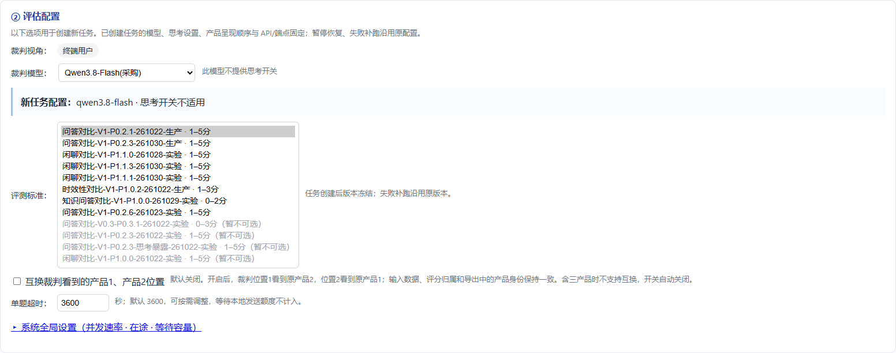

# Prompt 展示名称映射

本表保留规范展示名称、原展示名称及精确协议身份的对应关系。命名只作用于界面展示；协议 ID、`standard_version`、`bundle_revision`、原 `CompareProtocol.display`、协议状态、公开元数据、请求元数据和 prompt 正文保持原值。

名称结构为“评估类型-展示版本-P实现版本-prompt更新日期-使用标签”；思考暴露版保留“思考暴露”区分词。日期采用北京时间 `YYMMDD`，表示最近确实改变渲染 prompt 内容的日期。名称中的 `V1` 是批准的展示名称组成部分，不重写原协议的 `standard_version`。

| 协议 ID | bundle_revision | standard_version | 原展示名称 | 规范展示名称 | 当前可新建选择 |
| --- | --- | --- | --- | --- | --- |
| qa_competitor_compare@0.2-simplified | 0.2.1 | 0.2-simplified | V0.2 简化版（稳定） | 问答对比-V1-P0.2.1-261022-生产 | 是 |
| qa_competitor_compare@0.2-simplified-plus | 0.2.3 | 0.2-simplified-plus | V0.2 简化版（稳定plus）·1-5分 | 问答对比-V1-P0.2.3-261030-生产 | 是 |
| qa_competitor_compare@0.2-simplified-1022 | 0.2.6 | 0.2-simplified-1022 | V0.2简化版（1022优化） | 问答对比-V1-P0.2.6-261023-实验 | 是 |
| qa_chat_compare@1.1 | 1.1.0 | 1.1 | 问答闲聊V2·1-5分（候选） | 闲聊对比-V1-P1.1.0-261028-实验 | 是 |
| qa_chat_compare@1.1-demand-calibrated | 1.1.3 | 1.1-demand-calibrated | 问答闲聊V2·需求与分档校准·1-5分（候选） | 闲聊对比-V1-P1.1.3-261030-实验 | 是 |
| chitchat_evidence_first_flat@1.1 | 1.1.1 | 1.1 | 闲聊七维·证据先行·1-5分（候选） | 闲聊对比-V1-P1.1.1-261030-实验 | 是 |
| timeliness_compare@1.0 | 1.0.2 | 1.0 | 时效性评估V1·1-3分（候选） | 时效性对比-V1-P1.0.2-261022-生产 | 是 |
| knowledge_qa_compare@1.0 | 1.0.0 | 1.0 | 知识问答V1·0-2分（候选） | 知识问答对比-V1-P1.0.0-261029-实验 | 是 |
| qa_competitor_compare@0.3 | 0.3.1 | 0.3 | V0.3（实验） | 问答对比-V0.3-P0.3.1-261022-实验 | 否 |
| qa_competitor_compare@0.2-simplified-calibrated | 0.2.3 | 0.2-simplified-calibrated | V0.2 简化版·评分校准（实验） | 问答对比-V1-P0.2.3-261022-实验 | 否 |
| qa_competitor_compare@0.2-simplified-thinking-exposure | 0.2.3 | 0.2-simplified-thinking-exposure | V0.2 简化版·思考暴露优化（可用） | 问答对比-V1-P0.2.3-思考暴露-261022-实验 | 否 |
| qa_chat_compare@1.0 | 1.0.0 | 1.0 | 问答闲聊V1·1-5分（候选） | 闲聊对比-V1-P1.0.0-261022-实验 | 否 |

“生产／实验”是用户批准的展示标签，不决定协议的实际 `status` 或 `selectable`。新建任务的可选项继续以当前 registry 的 `selectable` 为准；例如时效性协议的实际状态仍是 `experimental`，命名为“生产”不会更改该状态。当前不可新建选择的四项仍不可选，历史任务继续可按原有逻辑查看。

只有表中的精确 `(evaluation_profile, bundle_revision)` 命中才使用规范名称。缺少实现版本、旧实现版本或未知协议使用调用方提供的原展示名称；没有原名称时回退协议 ID，不用当前名称推断或覆盖历史版本。

日期证据如下，均来自实际 prompt 模板正文的 Git 差异：

- `261022`：`fc57fdc` 修改产品背景归属规则及 USER 公共背景段，涉及简化稳定、V0.3、评分校准、思考暴露 r023、问答闲聊 V1 和时效性。
- 稳定 plus 的 `261030`：`c0bb796` 替换最新评分标准正文。
- 1022 的 `261023`：`f169f68` 实际修改 SYSTEM 理由格式和 JSON 转义自检；双、三产品共享构建器，所以不以仅转发的 dual/triple 文件日期作为正文日期。
- 问答闲聊 V2 的 `261028`：`70c931e` 修改情感表达、引导推荐及分档自检。
- 闲聊需求与分档校准的 `261030`：`2f2aaf4` 引入有证据扣分制正文。
- 闲聊七维 1.1.1 的 `261030`：`b4d8831` 增加原表条目索引与证据对照规则。10月31日的格式恢复提交 `df2ef0d` 没有修改 prompt，因此日期不变。
- 知识问答的 `261029`：`175af56` 修改合并理由合同和输出示例。

## 展示接入与历史兼容

可执行映射集中在 [prompt_names.py](../src/auto_eval/web/prompt_names.py)，本表通过测试与该目录逐项核对。配置接口在原协议元数据外提供 `canonical_name` 和 `prompt_name_catalog`，任务响应另提供 `evaluation_profile_display`；这些展示字段不写入冻结 manifest 或模型请求身份。

名称覆盖评估配置、历史筛选、任务队列、历史列表、当前结果及人工对照相关页面。筛选和任务提交仍使用原协议 ID；历史筛选覆盖同一协议的全部修订，选项附有“全部修订”提示。

新历史摘要保存冻结修订和原名称，读取时动态解析展示名。已有摘要侧车缺少修订信息时，不重读大型主快照，也不迁移或覆盖历史文件，保守显示原名；打开详情后可依据完整冻结 manifest 显示对应名称。身份字段冲突的摘要保留冲突标志，后续读取也不会把它误标为当前版本。

CSV、Excel 的原冻结协议名称与评估字段继续保留；本次统一的是界面展示标签。JSON 响应可携带独立展示字段，原始 prompt、产品数据、评分和结果不变。

## 页面验收

本机 Chrome 使用合成任务检查了全部 12 个名称、4 个停用选项、提交 ID 和历史修订回退，页面无脚本错误。下面第一张截图仅在验收时临时展开原选择框，便于同时核对全部选项。

## 回归验证

2026-10-31 完成后端 **2988 passed**、前端 **34 组通过**、真实 Chrome 页面验收。新增测试验证了全部映射、旧修订与缺失修订回退、身份冲突经摘要缓存往返仍保留原名，以及配置、队列、历史、数据复用和新建任务的展示字段。12 个协议的 `request_metadata()` SHA256 基线均与改名前一致。

后端命令为 `C:/workspace/venv/Scripts/python.exe -m pytest -q --basetemp C:/workspace/pnames_full --deselect tests/test_remote_media_inputs.py::test_download_cleanup_cannot_remove_history_or_follow_external_symlinks`，运行时 `PYTHONPATH` 指向当前仓库 `src`，`NO_PROXY=localhost,127.0.0.1,::1`。唯一排除项是此前已确认受本机 Windows 创建符号链接权限限制的既有用例（`WinError 1314`）；相关生产清理逻辑未改动。

部署后重启 Web 服务并刷新页面即可使用新标签，不需要迁移评测集或改写已保存任务。
