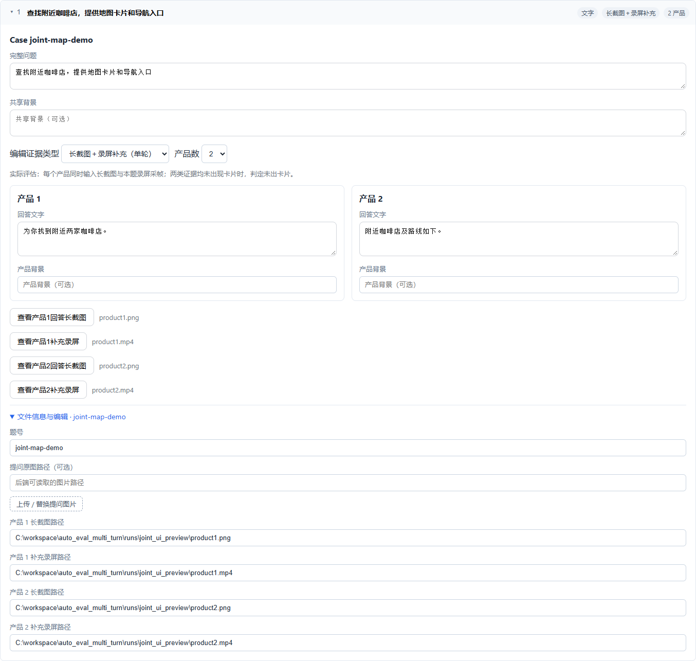
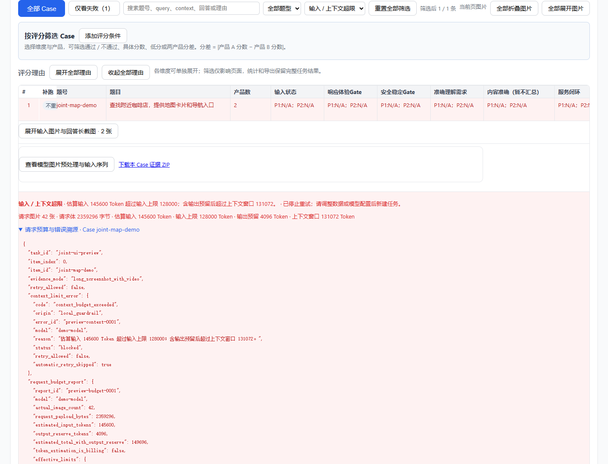

# 单轮长截图与录屏补充证据

## 输入和评分

仅在垂域视觉对比评测（`compare`）的**单轮 Case**启用新模式。页面展开 Case 后，在“编辑证据类型”选择“长截图＋录屏补充（单轮）”。每个产品都需要填写长截图和同一问题、同一回答的录屏路径；支持双产品、三产品及单张提问图片。

JSON 支持单个对象或数组，JSONL 每行一个对象。CSV 支持同名标准字段，数字字段自动解析，`query_images` 使用 JSON 数组字符串。

```json
{
  "id": "map-001",
  "query": "从当前位置导航到最近的地铁站",
  "product_count": 2,
  "evidence_mode": "long_screenshot_with_video",
  "screenshot1": "data/product1/map.png",
  "video1": "data/product1/map.mp4",
  "screenshot2": "data/product2/map.png",
  "video2": "data/product2/map.mp4",
  "task_start_time": 0,
  "task_end_time": 18.5
}
```

时间窗字段可省略，单位为秒；三产品增加 `screenshot3`、`video3` 并设置 `product_count: 3`。路径必须在服务器允许的媒体目录内。视频必须对应当前题目；如包含其他题目，需要声明本题时间窗。补充帧会按真实采样时间排序，并剔除时间窗外的帧。

未显式选择 `long_screenshot_with_video` 时，沿用旧规则：所有产品长截图齐全则使用长截图，否则所有产品录屏齐全才回退录屏。历史任务不会自动变成联合模式。

多轮继续使用原来的逐轮长截图、题图及原始历史上下文。带 `session_id` / `turn_index` 的数据不能选择联合证据，也不能添加录屏。

长截图保留原有切片方式，负责完整回答、结构和排版。录屏复用现有采帧算法，按既有上限采样并编码，补充手机页面的卡片及局部画面。模型在一次评测请求中收到“产品1长截图 → 产品1录屏帧 → 产品2长截图 → 产品2录屏帧”的顺序，三产品同理；每张图片都有产品和位置标识，视频帧额外标注秒数。

联合模式的 Prompt 单独适配，冻结版本为 `single-turn-joint-v1`，不改写旧评测标准模板。判定规则：

- 任一来源出现卡片、Superlink、Chips 等组件，则认定该产品提供了该组件。
- 本产品长截图及全部补充帧均未出现组件，则判定未提供；不能仅因此标记证据不足、N/A 或人工复核。
- 维度是否适用仍由问题和评分标准决定。例如问题需要服务闭环时，全部产品都未出卡片也应继续评分。
- 两类证据中的同一卡片不重复计数。流式中间态需结合后续画面判断；纯文字不能证明画面里存在组件，静态证据不能证明点击成功。

这次不增加卡片识别模型或额外模型调用，也不保证抽样覆盖视频每一帧。

## 请求预算和超限处理

联合模式会在模型调用前检查**实际编码后**的全部图片、全部文本和请求体，包含提问图片、全部产品长截图切片、录屏补充帧、采样参数及输出预留。不会因为超限而静默裁掉证据。

管理员可在 `config/judges.yaml` 的裁判或 `judge_model_profiles` 项中配置正整数 `max_input_tokens`、`context_window`。所选模型的配置会冻结到新任务，恢复或补跑沿用冻结值。更换到其他模型不会继承原模型上限，需为该模型单独声明。

```yaml
max_input_tokens: 260096
context_window: 262144
```

当前配置明确声明上述**平台保守上限**，并非对所接网关限制的官方核验。联合请求取模型声明和视觉配置中更严格的上限；本次没有放宽 `query_images` / `long_screenshot` 的既有保护值。管理员应按实际模型、地域和网关文档调整声明。模型原生上下文可参考 [Qwen3.5-397B-A17B 模型卡](https://huggingface.co/Qwen/Qwen3.5-397B-A17B)，服务部署仍可能采用更小限制。

Token 使用保守估算：文本 UTF-8 字节数，加编码图片的 32px patch 估算和每图固定预留。这个数值用于提前阻断，不是实际计费 Token；实际用量以模型返回 usage 为准。由于估算保守，接近边界的输入可能被提前阻断。

本地超预算时不发送模型请求。网关返回上下文超限时立即停止；即使包装成 HTTP 429/500 或流内错误，也不进入 SDK 重试、流式 usage 参数降级、Runner 重试、失败补跑或暂停恢复。JSON 格式修复请求同样受已声明模型上限保护，修复请求超限也不重试。TPM 限流、普通网络错误及输出截断仍按各自原有规则处理。

原样重新提交已标记不可重试的 Case 会被拒绝；调整问题、回答、证据、时间窗等输入后可以重新评测，并保留旧超限记录及重新评测审计。修改模型配置后请创建新任务。

## 展示、导出和溯源

结果页显示输入 / 上下文超限警示、具体原因和“已停止重试”，并支持按超限筛选。展开“请求预算与错误溯源”可以查看模型、Case、任务请求编号、网关请求编号（供应商有返回时）、预算报告和错误来源。

任务快照和错误日志保留 `request_budget_report`、`context_limit_error` / `request_limit_error`、`retry_allowed: false`、错误编号，以及请求及图片 SHA256。预算报告包含估算输入 Token、输出预留、有效上限及来源、请求字节数、图片数量、实际尺寸、产品归属和视频时间戳。JSON 修复失败的审计另标记 `failed_request_purpose: json_repair`，保留该次请求预算，避免与原评测请求混淆。

Excel 增加“请求预算与错误”工作表，原有视觉证据清单及请求图片序列同时保留长截图和录屏帧。默认仍不在 Excel 内嵌原图。证据 ZIP 保存实际发送的编码图片及 Prompt 顺序，来源图片哈希和发送图片哈希分别保留；录屏下载仍指向原始视频。

界面验证使用隔离的模拟数据，不调用真实模型、不改写已有任务：




